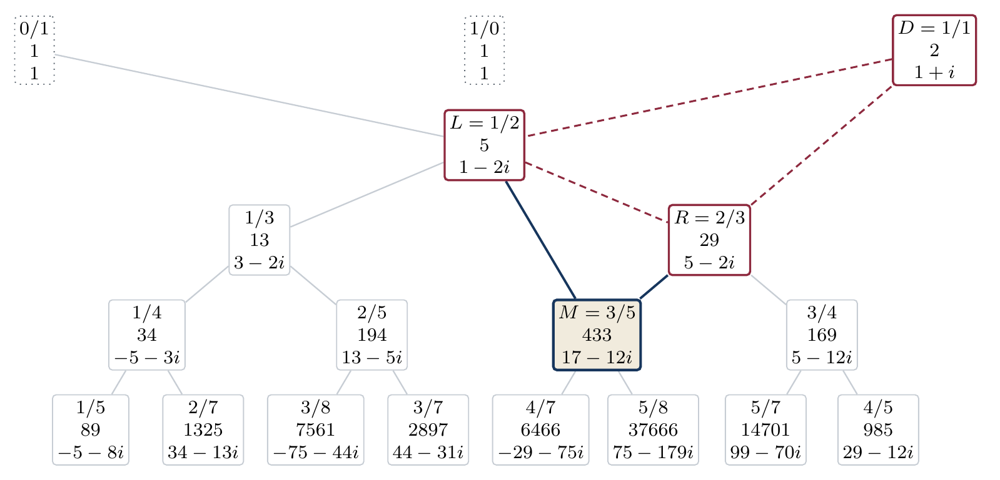

<!--
Around the Markov uniqueness conjecture: manuscripts and reproduction
material.

Authors:
  Dr. Denys Dutykh (Mathematics Department, Khalifa University of Science
  and Technology, Abu Dhabi, UAE)
  Prof. Laurent Vuillon (Univ. Savoie Mont Blanc, CNRS, LAMA, Chambéry,
  France)
-->

# fibonacci-pell-nearest-gaps: around the Markov uniqueness conjecture



The Vieta tree of the fifth manuscript. Each fraction `P/Q` of the first four
generations of the Farey tree carries its Markov number `m` and a Gaussian
integer `α` with `m = |α|²`, computed by the Vieta jump of that manuscript
alone from the values at the three starting fractions `0/1`, `1/1` and `1/0`
at the top. In wine and dashed, the Farey triangle `L = 1/2`, `R = 2/3`,
`D = 1/1`; in navy, the edges from its parents to the mediant `M = 3/5`,
whose Gaussian integer `17 − 12i` is the conjugate of `(5 + 29i)/(1 + i)`,
and indeed `17² + 12² = 433`.

This repository is the public home of a series of manuscripts by Denys Dutykh
and Laurent Vuillon around the uniqueness conjecture for Markov numbers, and of
everything needed to re-run their computations: the LaTeX sources and compiled
PDF of each manuscript, and its supplement of exact programs in integer or
rational arithmetic.

## The question behind the series

A Markov triple is a positive integer solution of

```text
x² + y² + z² = 3xyz
```

and every such triple is obtained from `(1, 1, 1)` by repeatedly replacing one
coordinate through the Vieta involution, so that the solutions form a tree. The
largest coordinate of a triple is its Markov number. Frobenius asked in 1913
whether a Markov number determines its triple: whether, for each `m`, there is
at most one triple whose maximum is `m`. The question is still open, and it is
the question this series circles.

Each manuscript here attacks one face of it and proves what can be proved
completely, on a domain stated without hidden hypotheses. None of them claims
the conjecture, and each says in its own words where its boundary lies. What
they share is a method: analytic estimates first, cutting an unbounded problem
down to a finite domain, and only then an exact computation over that domain,
carried out in integer or rational arithmetic and reproducible from the
supplement that travels with the manuscript.

Every manuscript directory is self-contained: its own sources, its own
bibliography, its own build, its own supplement. Nothing below `papers/`
reaches into anything else.

## The manuscripts

| No | Manuscript | Directory | Pages | Supplement |
| --- | --- | --- | --- | --- |
| 1 | Fibonacci–Pell nearest gaps: an all-exponent classification and quadratic-unit orbit rigidity | [`papers/01-fibonacci-pell-nearest-gaps`](papers/01-fibonacci-pell-nearest-gaps) | 46 | 21 exact programs |
| 2 | Endpoint costs and balanced near-minimizers under Gaussian reflections | [`papers/02-endpoint-costs-balanced-paths`](papers/02-endpoint-costs-balanced-paths) | 20 | 3 exact computations over a complete finite graph |
| 3 | Effective trace bounds and rigidity for simple curves on the modular torus | [`papers/03-effective-markoff-traces`](papers/03-effective-markoff-traces) | 33 | 14 exact programs: occurrence classification, polynomial proofs, residue cover |
| 4 | Rational reflections and palindromic words in the Cohn monoid | [`papers/04-palindromic-reflection-rigidity`](papers/04-palindromic-reflection-rigidity) | 38 | 7 exact checks, an enumeration of all palindromes with label up to 10²⁶, and a search at every palindromic centre |
| 5 | Euclidean minimality of Markov representations on thirteen Farey rows | [`papers/05-thirteen-farey-rows`](papers/05-thirteen-farey-rows) | 40 | 13 exact checks, each finite assertion verified twice independently, and censuses of margins and of directives up to 10¹² |

The first classifies, for every `q ⩾ 1`, every sign and every positive exponent
`n`, the strict factor-two gaps between a power of the Pell unit `λ = 1 + √2`
and the square of a Fibonacci-built element of `Z[√2]` whose norm is minus the
square of its content. Exactly two such gaps exist, none with an odd exponent,
and a companion theorem lists every Pell-orbit hit of the two signed Fibonacci
cores. Its own README states the results and their boundary in full.

The second proves a stability theorem for Euclidean costs along a finite graph
of continued-fraction states: when each cyclic component of the zero-weight
subgraph has a single letter frequency, the letter count of every balanced
accepted word stays within an explicit multiple of its completed cost from that
finite set. It applies the theorem to the Gaussian reflection attached to
`89 = 8² + 5²`, showing that every distinct reflected target of a genuine
reduced Markov source has strictly larger cost, by an amount growing linearly
with the denominator of the Farey slope away from four critical slopes.

The third studies equal traces of simple closed geodesics on the modular
once-punctured torus, with the number `h` of occurrences of one curve in the
Christoffel word of the other held fixed. For every `h ⩾ 2` it gives a complete
decision procedure, with `O(h⁵)` exact comparisons, and an exact test for
surface isometry. Every primitive occurrence family with `2 ⩽ h ⩽ 6` contains
only isometric equalities, and every equal-length pair of simple curves with
intersection number at most 24 is isometric.

The fourth studies, for a palindrome `p` in the free monoid generated by the two
Cohn matrices, the rational reflection of the plane that fixes the column
`(2, 1)` and is orthogonal for the Gram form of `p`. It classifies every finite
word whose terminal column the reflection carries to another word column: these
are exactly the concatenations of the blocks `ab·p` and `ba·p`, which the
reflection exchanges. For palindromes this shows that two of them with the same
Gram label and a root midpoint at the ratio of the centre are exchanged around
it, so that no two distinct central occurrences collide at such a midpoint. Away
from the midpoint it proves a fourth-power bound on the label of a common
ancestor when the parent imbalance is bounded. An exact enumeration of all
16 743 538 palindromes with label at most `10²⁶` finds no coincidence of labels
that the exchanges do not produce, which supports a conjecture on twins whose
proof would imply the uniqueness conjecture. No result there excludes every
displaced central pair.

The fifth starts from the representation of a Markov number as a sum of two
coprime squares that each occurrence induces: for the reduced Farey fraction
`P/Q`, the subtractive Euclidean algorithm reduces this pair in exactly
`P + Q − 2` steps. It proves that no other primitive representation of the
same number has a shorter Euclidean algorithm when `P ⩽ 13`, with no bound on
the denominator. A parity-order theorem for the Fibonacci-normalized norm
reduces infinite families of Euclidean paths to two exact corner values,
complete Gaussian factorizations settle 248 labels, and the remaining finite
assertions are verified by computer in exact arithmetic, each twice
independently. Minimality on every row would imply the uniqueness conjecture;
the article conjectures that it holds, and states a second conjecture, on
iterated palindromic closure and the Thue–Morse morphism, that also implies
uniqueness and is verified for every Markov number up to `10¹²`.

## Repository layout

```
.
├── README.md      this file: the series, its manuscripts, how to build them
├── LICENSE        GNU LGPL v2.1, covering everything in the repository
├── CITATION.cff   citation metadata for the repository as a whole
├── Makefile       forwards every target to each manuscript below papers/
├── docs/figures/  the picture at the top of this page and its LaTeX source
│
└── papers/
    ├── 01-fibonacci-pell-nearest-gaps/
    │   ├── README.md                     the results, the boundary, the build
    │   ├── Makefile                      strict build and reproduction targets
    │   ├── DD-LV-Fibonacci-Pell-Gaps.tex main file
    │   ├── DD-LV-Fibonacci-Pell-Gaps.pdf compiled manuscript, tracked
    │   ├── references.bib                bibliography
    │   ├── sections/                     one file per section
    │   └── supplement/                   supplementary material
    │
    ├── 02-endpoint-costs-balanced-paths/
    │   ├── README.md                     the results, the boundary, the build
    │   ├── Makefile                      strict build and reproduction targets
    │   ├── DD-LV-Endpoint-Costs-Balanced-Paths.tex  main file
    │   ├── DD-LV-Endpoint-Costs-Balanced-Paths.pdf  compiled manuscript, tracked
    │   ├── references.bib                bibliography
    │   ├── sections/                     one file per section
    │   ├── figures/                      the figure sources
    │   ├── tools/                        the strict build gate
    │   └── supplement/                   supplementary material
    │
    ├── 03-effective-markoff-traces/
    │   ├── README.md                     the results, the boundary, the build
    │   ├── Makefile                      strict build and reproduction targets
    │   ├── DD-LV-Effective-Markov-Traces.tex  main file
    │   ├── DD-LV-Effective-Markov-Traces.pdf  compiled manuscript, tracked
    │   ├── references.bib                bibliography
    │   ├── sections/                     one file per section
    │   ├── figures/                      the figure sources
    │   ├── tools/                        the strict build gate
    │   └── supplement/                   supplementary material
    │
    ├── 04-palindromic-reflection-rigidity/
    │   ├── README.md                     the results, the boundary, the build
    │   ├── Makefile                      strict build and reproduction targets
    │   ├── DD-LV-Palindromic-Reflection-Rigidity.tex  main file
    │   ├── DD-LV-Palindromic-Reflection-Rigidity.pdf  compiled manuscript, tracked
    │   ├── references.bib                bibliography
    │   ├── sections/                     one file per section
    │   ├── figures/                      the figure sources
    │   ├── tools/                        the strict build gate
    │   └── supplement/                   supplementary material
    │
    └── 05-thirteen-farey-rows/
        ├── README.md                     the results, the boundary, the build
        ├── Makefile                      strict build and reproduction targets
        ├── DD_LV_Thirteen_Farey_Rows.tex main file
        ├── DD_LV_Thirteen_Farey_Rows.pdf compiled manuscript, tracked
        ├── references.bib                bibliography
        ├── sections/                     one file per section
        ├── figures/                      the figure sources
        └── supplement/                   supplementary material, with the strict build gate
```

The picture at the top of this page is the TikZ figure
`papers/05-thirteen-farey-rows/figures/vieta-tree.tex` of the fifth manuscript,
drawn alone by `docs/figures/vieta-tree.tex`; the command that renders it is in
the first lines of that file.

## Quick start

A manuscript is built from its own directory with `make`, exactly as if it were
alone in a repository of its own:

```sh
cd papers/01-fibonacci-pell-nearest-gaps
make            # build the PDF under that manuscript's strict warning gates
make help       # every target that manuscript offers
make checks     # run the reproduction programs of its supplement
```

The `Makefile` at the top of the repository does no work itself. It discovers
the manuscript directories below `papers/` and forwards to each of them, so the
whole series is built and checked with one command:

```sh
make            # build every manuscript PDF
make check      # force a full rebuild of every manuscript
make checks     # run every supplement
make release    # rebuild everything, then run every supplement
make clean      # remove build intermediates everywhere
make list       # the manuscript directories that were discovered
make help       # the above, with the discovered directories listed
```

One manuscript at a time is reached by its directory name, as `make
01-fibonacci-pell-nearest-gaps` to build it, or `check-…`, `checks-…`,
`release-…`, `clean-…` for the other verbs.

## Requirements

Requirements are stated by each manuscript. In general they amount to a TeX
Live installation with `latexmk` and `bibtex`, and Python 3.10 or later (the
first manuscript asks for 3.11 or later) with no network access and no
nondeterminism. The supplements need no third-party package, except those of
the third, fourth and fifth manuscripts, whose symbolic checks use SymPy. The
two censuses of the fifth, which stand outside its fixed checks, use PARI/GP
and Julia.

## What a manuscript directory contains

A directory under `papers/` is numbered in the order the manuscripts joined the
series, followed by a short name, as `02-endpoint-costs-balanced-paths`. It
holds the LaTeX sources of one manuscript and nothing else: the main file, the
sections, the bibliography, the compiled PDF, a README stating the results and
their boundary, a supplement carrying the reproduction material, and a
`Makefile`.

That `Makefile` is the only thing the series asks of it. Five target names are
common to every manuscript, which is what lets the top-level `Makefile` treat
them alike: `all` builds the PDF, `check` forces a full rebuild under whatever
strict gates that manuscript imposes, `checks` runs the reproduction programs
of its supplement, `release` does both, and `clean` removes the build
intermediates. A manuscript may offer further targets of its own, and those are
reached directly with `make -C papers/<directory> <target>`.

Working notes, plans and internal reviews stay in the research tree and do not
enter this repository. What lands here is the manuscript, the material a reader
needs to check it, and the record of what that material establishes.

## How to cite

None of the five manuscripts has been published yet. Until they are, please
cite this repository as software, and name the manuscript you rely on:

D. Dutykh and L. Vuillon, Around the Markov uniqueness conjecture: manuscripts
and reproduction material, software, version 2.5.1 (2026).

https://github.com/dutykh/fibonacci-pell-nearest-gaps

The button "Cite this repository" in the right-hand column of this page gives
the same reference, read from `CITATION.cff`, which also lists the five
manuscripts. The README of each manuscript gives a BibTeX entry for it.

## Licence

Everything in this repository, manuscript sources and supplements alike, is
released under the GNU Lesser General Public License, version 2.1. The full
text is in [`LICENSE`](LICENSE).

## Authors

Denys Dutykh, Mathematics Department, Khalifa University of Science and
Technology, PO Box 127788, Abu Dhabi, United Arab Emirates
&lt;denys.dutykh@ku.ac.ae&gt;

Laurent Vuillon, Univ. Savoie Mont Blanc, CNRS, LAMA, 73000 Chambéry, France
&lt;laurent.vuillon@univ-smb.fr&gt;

https://www.denys-dutykh.com/
